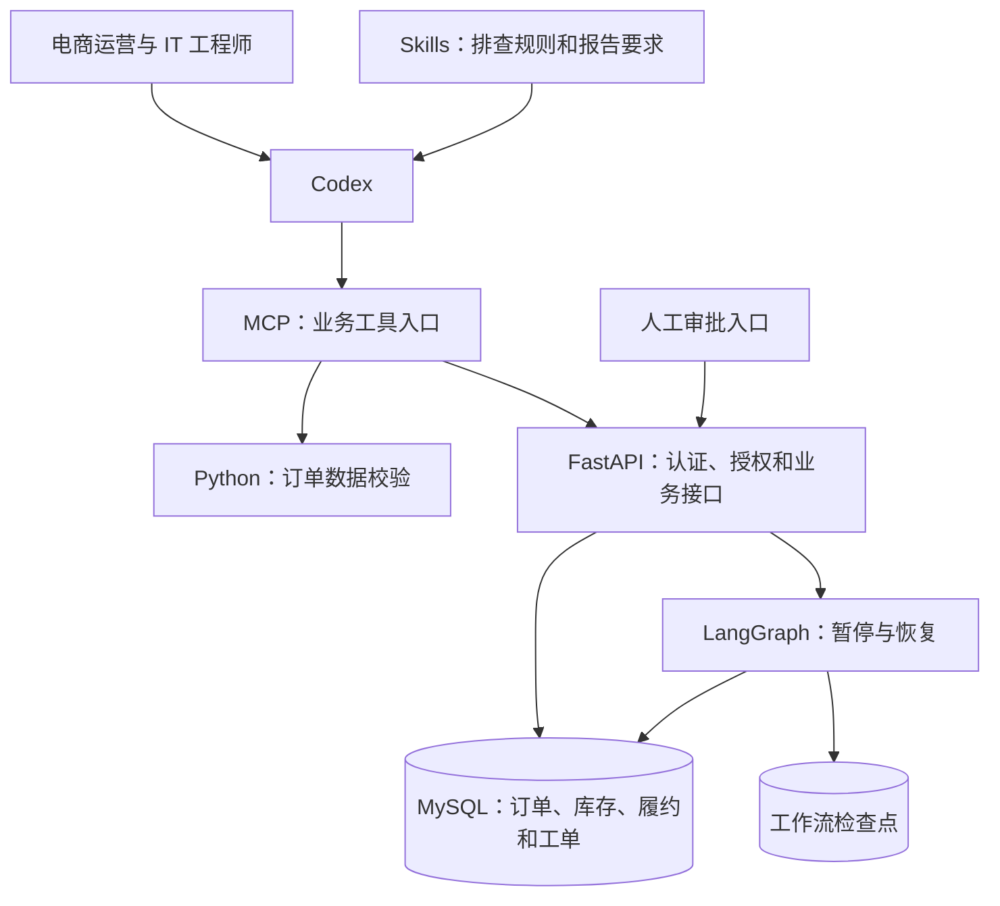

# 第一章：项目背景与架构

## 1.1 从电商 IT 工程师的一项工作开始

电商订单付款后，通常需要经过库存分配、仓库出库和物流交接。订单超过承诺时间仍未发货，可能涉及库存不足、仓库拦截或履约记录缺失。

IT 工程师需要把订单、库存和履约信息连起来，说明已经查到的事实，并将需要处理的问题交给相应人员。仅有一张“超时订单列表”，还不足以完成这项工作。

公司已经有 MySQL 数据库、FastAPI 接口和 Python 程序。本项目把这些已有能力接入 Codex，让员工从一个自然语言入口完成排查。

贯穿项目的请求是：

> 检查店铺 A 在 2026 年 10 月 10 日付款、截至 2026 年 10 月 11 日 12:00 已超过 24 小时仍未发货的订单。结合库存和履约记录说明可能原因，生成异常清单和处理建议。需要创建处理工单的，先给我确认。

这里使用固定日期，是为了让同一份示例数据在不同日期运行时得到一致结果。真实业务中的“昨天”，需要先依据公司采用的业务时区转换为明确日期。

## 1.2 最终要交付什么

一次完整排查包含三类成果：

| 成果 | 内容 | 核对方式 |
| --- | --- | --- |
| 异常清单 | 订单编号、付款时间、超时时长、相关证据 | 与业务接口返回值逐项对应 |
| 排查报告 | 已知事实、可能原因、待核实事项、建议 | 区分证据与推断 |
| 处理记录 | 工作流编号、人工决定、工单编号、当前状态 | 查询服务端持久化记录 |

“生成建议”和“创建工单”是不同操作。查询可以直接执行，工单写入必须经过独立的人工确认流程。

模型生成一句“用户已批准”，不会自动成为服务端认可的审批记录。

## 1.3 组件怎样配合

各组件只承担自己适合的工作：

| 组件 | 本项目中的职责 |
| --- | --- |
| Codex | 理解请求、选择工具、整理解释与报告 |
| Skills | 保存业务步骤、证据要求和输出规范 |
| MCP | 把现有程序与接口包装成可发现、可调用的工具 |
| Python | 执行字段检查等确定性逻辑 |
| FastAPI | 校验输入、验证身份、限定店铺范围、执行业务操作 |
| MySQL | 保存业务数据与处理结果 |
| LangGraph | 保存流程状态，在人工确认处暂停，确认后恢复执行 |

Codex 无需直接连接数据库。它调用“查询超时订单”“查询订单证据”等业务工具，具体如何访问数据库由服务端决定。

## 1.4 Skill 与 MCP 的连接点

MCP 工具回答“系统允许调用什么能力”。例如，`ecommerce_order_evidence` 接收订单编号，返回订单、库存和履约证据。

Skill 回答“面对某种任务，应怎样组合这些能力”。例如，先查询超时订单，再逐笔读取证据，最后按固定格式输出报告。

如果只有工具，没有业务步骤，Agent 可能漏查库存或把无履约记录直接判断为仓库故障。如果只有步骤，没有工具，Agent 无法获得真实订单数据。

服务端权限不能依赖 Skill 中的文字。即使提示词要求查询店铺 B，店铺 A 的凭据也不能读到店铺 B 的订单。

## 1.5 明确业务口径

本项目采用以下规则：

| 规则 | 定义 |
| --- | --- |
| 业务时区 | UTC+08:00 |
| 付款日期 | `2026-10-10`，按业务时区计算 |
| 排查时间 | `2026-10-11T12:00:00+08:00` |
| 超时条件 | 排查时间减付款时间严格大于 24 小时 |
| 状态条件 | 订单仍为 `paid` |
| 权限范围 | Agent 凭据限定店铺 A |

正好满 24 小时不满足“超过 24 小时”。已经发货或已经取消的订单，不进入本次超时未发货清单。

## 1.6 阅读示例订单

| 订单 | 关键情况 | 本次结果 |
| --- | --- | --- |
| A1001 | 10 月 10 日 08:00 付款，数量 2，当前库存 0 | 纳入；库存不足是排查方向 |
| A1002 | 10 月 10 日 09:00 付款，当前库存 20，有仓库拦截记录 | 纳入；核实仓库拦截原因 |
| A1003 | 10 月 10 日 10:00 付款，当前库存 20，无履约记录 | 纳入；核实履约任务是否建立 |
| A1004 | 10 月 10 日 18:00 付款 | 排查时未超过 24 小时，不纳入 |
| A1005 | 已发货 | 不纳入 |
| A1006 | 已取消 | 不纳入 |
| B1001 | 属于店铺 B | 店铺 A 凭据无权查看 |

预期得到 A1001、A1002、A1003 三笔异常订单。这个结果可以作为后续接口、MCP 和完整流程的共同核对依据。

当前库存不足只能证明查询时库存不足，不能单独证明订单付款时也缺货。仓库拦截记录能够说明存在拦截，但不必然解释拦截产生的全部原因。报告应保留这些证据边界。

## 1.7 一次业务请求怎样执行

1. Codex 将日期和排查时间转换为明确的工具参数。
2. MCP 调用业务接口，按服务端店铺权限查询超时订单。
3. Codex 逐笔查询库存和履约证据，按 Skill 输出排查报告。
4. 需要处理时，启动 LangGraph 工作流，取得工作流编号。
5. 工作流在人工确认点暂停，等待独立审批入口记录决定。
6. 确认通过后恢复流程，由服务端创建工单并返回结果。

工作流编号是继续处理同一业务流程的依据。关闭聊天窗口、重新连接 MCP 或更换模型，都不意味着业务状态已经重新开始。

## 1.8 从已有系统逐层接入

接下来先运行配套业务工程，确认 Python 校验程序和 FastAPI 查询可以独立工作。随后接入 MCP，制作 Skill，再加入 LangGraph 的人工确认流程。

这样每增加一层，都有明确的输入、输出与核对依据。遇到问题时，可以判断它发生在数据、业务接口、MCP 工具还是 Agent 的调用过程。

[返回项目篇目录](README.md)
