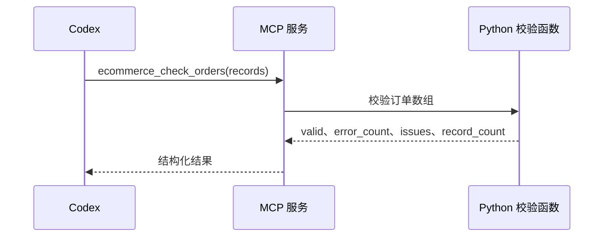

# 第三章：接入已有 Python 程序

## 3.1 先认识要接入的程序

公司已有一个订单数据校验程序，用于检查从业务系统导出的订单记录。它不负责查询数据库，也不判断订单是否超时，而是回答：这批数据是否符合约定的数据结构？

程序位于 [app/checker.py](../../代码/ecommerce-agent/app/checker.py)。命令行与 MCP 工具复用同一套检查逻辑，避免出现“直接运行认为错误，Agent 调用却认为正确”的差异。

接入前需要明确四件事：输入是什么、输出是什么、哪些情况属于业务异常、哪些情况属于执行失败。

## 3.2 输入契约

输入是最多 1000 个订单对象组成的 JSON 数组。每条记录检查以下字段：

| 字段 | 含义 | 约束 |
| --- | --- | --- |
| `id` | 订单编号 | 必须存在，批次内不能重复 |
| `status` | 订单状态 | `paid`、`shipped`、`cancelled` |
| `paid_at` | 付款时间 | 必须包含时区信息 |
| `quantity` | 商品数量 | 正整数 |

下面是一条符合约定的记录：

```json
[
  {
    "id": "DEMO001",
    "status": "paid",
    "paid_at": "2026-10-10T08:00:00+08:00",
    "quantity": 2
  }
]
```

时间中的 `+08:00` 指明时区。缺少时区的时间字符串容易导致跨地区系统按不同标准解释同一个时刻，因此不被校验程序接受。

数量是数值 `2`，而不是字符串 `"2"`。数据校验阶段发现类型不正确时，应返回问题，不应由模型悄悄改成它认为合理的值。

## 3.3 先从命令行运行

在 `代码/ecommerce-agent` 目录执行：

```powershell
uv run --frozen python -m app.checker samples/orders.json
$LASTEXITCODE
```

输入样例见 [samples/orders.json](../../代码/ecommerce-agent/samples/orders.json)，包含 3 条有效记录。校验结果写到标准输出，可由终端、自动化程序或其他 Python 程序读取；读取和解析失败时，执行错误写到标准错误输出。

输出包含以下信息：

| 字段 | 说明 |
| --- | --- |
| `valid` | 是否通过校验 |
| `error_count` | 检出的错误数量 |
| `issues` | 具体问题集合 |
| `record_count` | 输入记录数量 |

退出码用于区分不同结果：

| 退出码 | 含义 | 调用方应该怎样处理 |
| --- | --- | --- |
| `0` | 数据通过校验 | 可以继续后续流程 |
| `1` | 数据存在问题 | 读取问题集合，修复或退回数据 |
| `2` | 输入读取或解析失败 | 检查路径、JSON 格式等执行条件 |

数据有问题，并不表示程序没有运行成功。程序能够明确指出错误字段，本身就是一次有价值的业务执行结果。

## 3.4 把程序包装成 MCP 工具

对应工具名为 `ecommerce_check_orders`，接收 `records` 数组。工具实现位于 [app/mcp_server.py](../../代码/ecommerce-agent/app/mcp_server.py)。

调用过程如下：



这里直接接收数据数组，无需让模型拼接任意命令行，也无需让工具接受任意本地文件路径。文件读取留给命令行入口，业务校验函数只处理传入的数据。

MCP 工具不是重新实现一个校验器。它增加的是工具名称、参数描述以及调用接口，底层仍然复用已有 Python 逻辑。

## 3.5 在 Codex 中通过 HTTP 发起调用

本章采用 **Streamable HTTP**：MCP作为独立服务运行，Codex通过URL连接。本机端点为 http://127.0.0.1:8001/mcp 。

| 地址或入口 | 用途 |
| --- | --- |
| http://127.0.0.1:8000/ | 浏览器前端工作台 |
| http://127.0.0.1:8000/orders | 业务HTTP接口，供MCP查询工具访问 |
| http://127.0.0.1:8001/mcp | MCP协议端点，供Codex连接 |
| app/mcp_server.py | 定义六项工具，也保留stdio测试入口 |
| app/mcp_http.py | 复用工具，提供HTTP服务与令牌校验 |

业务HTTP接口与MCP使用不同协议。不要将/orders填入Codex的MCP配置，也不要把/mcp当作普通网页判断连接是否可用。

### 第一步：启动MCP服务

在工程根目录新开PowerShell。第00篇的前端/API可以继续运行，本窗口单独启动MCP：

~~~powershell
$env:AGENT_TOKEN = '填写与API端一致的Agent令牌'
$env:API_BASE_URL = 'http://127.0.0.1:8000'
uv run --frozen python -m app.mcp_http
~~~

默认监听127.0.0.1:8001，启动后保留窗口。需要换端口时追加 --port 8002，并同步修改Codex中的URL。

MCP只读取本窗口提供的Agent令牌和API地址，不加载.env中的数据库或审批凭据。本课程用同一Agent令牌保护本机MCP连接及调用业务API，是单Agent教学配置，不是企业多用户认证方案。

ecommerce_check_orders直接调用校验函数，本章只运行它时不需要业务API。后续订单查询、证据和工作流工具需要8000端口的API正常运行。

### 第二步：配置Codex连接URL

打开自己的Codex配置文件，通常为用户目录下的 .codex/config.toml，将[HTTP配置示例](../../代码/ecommerce-agent/examples/codex-mcp.toml)合并进去：

~~~toml
[mcp_servers.ecommerce]
url = "http://127.0.0.1:8001/mcp"
bearer_token_env_var = "AGENT_TOKEN"
startup_timeout_sec = 20
tool_timeout_sec = 30
~~~

已有旧ecommerce配置时，用这节替换旧节，移除该节的command、args、cwd和env_vars。其他服务和模型配置保留，同名节不要重复。

url指定MCP端点；bearer_token_env_var让Codex从环境读取令牌并发送Authorization请求头。配置方式见[Codex官方MCP说明](https://learn.chatgpt.com/docs/extend/mcp#streamable-http-servers)。

本例使用本地Bearer令牌，不需要执行codex mcp login；该命令用于服务器提供OAuth登录时的流程。

### 第三步：从具有令牌的终端启动Codex

再开PowerShell，进入工程目录：

~~~powershell
$env:AGENT_TOKEN = '填写与MCP服务端一致的Agent令牌'
codex mcp list
codex
~~~

HTTP方式下，Codex只需要端点和连接令牌，不负责启动Python子进程，也不需要API_BASE_URL；API地址由MCP服务使用。

CLI和IDE/桌面的进程环境不自动同步。使用其他入口时，要让对应进程获取AGENT_TOKEN，配置后重启客户端。不将真实令牌写入共享配置。

codex mcp list用于查看登记配置；进入Codex后通过/mcp检查实际连接与工具列表。看到ecommerce_check_orders等六项工具后再调用。缺少令牌或值不一致返回401；服务未启动则连接失败。

### 第四步：实际调用校验工具

~~~text
请使用 ecommerce_check_orders 检查一条订单：
id 为 DEMO001，status 为 paid，
paid_at 为 2026-10-10T08:00:00+08:00，quantity 为 2。
请实际调用工具，根据返回值说明记录数量、是否通过和错误数量。
~~~

预期工具参数：

~~~json
{
  "records": [
    {
      "id": "DEMO001",
      "status": "paid",
      "paid_at": "2026-10-10T08:00:00+08:00",
      "quantity": 2
    }
  ]
}
~~~

结果应为1条记录、valid=true、error_count=0。查看工具调用记录，确认结论来自实际执行。

~~~text
Codex → Streamable HTTP：127.0.0.1:8001/mcp
      → ecommerce_check_orders
      → app.checker.check_orders
      → 结构化结果
~~~

HTTP连接不保存订单工作流状态。后续仍用workflow_id定位服务端持久化记录；MCP重连不等于重新创建业务流程。

## 3.6 查看异常数据的返回

将上一条记录的 `quantity` 改为 `0`，再次调用：

> 使用 ecommerce_check_orders 检查同一条 DEMO001 订单，但 quantity 为 0。请保留原始输入，不要自动修复，列出工具返回的问题。

数量不符合正整数要求，结果应为未通过，并包含数量相关问题。将两条相同编号记录同时传入，还会触发订单编号重复检查。

如果 MCP 服务没有启动，或工具参数本身不符合工具定义，就不能把结果写成“数据校验通过”。这时应先处理工具连接或调用错误。

## 3.7 给已有程序增加 Agent 入口的关键

这个案例的核心是建立稳定契约。原来的 Python 程序继续负责确定性判断；MCP 负责暴露能力；Codex 根据结构化结果组织说明。

相同方法也适用于库存文件校验、订单金额核对和履约数据格式检查。接入前先把输入、输出和失败方式解释清楚，再决定工具应该暴露哪些参数。

## 3.8 从已有函数到工具实现

checker.py 是原有程序，mcp_server.py 是新增适配层。先关注 ecommerce_check_orders 的函数复用，再看其余工具如何复用 request。返回类型写为 dict[str, Any]，使本项目锁定的 MCP SDK 能生成结构化输出；单写 dict 不应被假定为同等行为。READ/WRITE 注解帮助客户端理解副作用，真正授权仍由 API 执行。

<details>
<summary>app/checker.py 完整代码</summary>

```python
"""已有 Python 程序：校验订单基础字段，不依赖 MCP、数据库或模型。"""
import json
import sys
from datetime import datetime
from pathlib import Path


def check_orders(records: list) -> dict:
    if not isinstance(records, list) or len(records) > 1000:
        raise ValueError("输入必须为最多 1000 条记录的数组")
    issues = []
    seen = set()
    for row, record in enumerate(records, 1):
        errors = []
        if not isinstance(record, dict):
            issues.append({"row": row, "errors": ["记录必须为对象"]})
            continue
        order_id = record.get("id")
        if not isinstance(order_id, str) or not order_id.strip():
            errors.append("id 必须为非空字符串")
        elif order_id in seen:
            errors.append("id 重复")
        else:
            seen.add(order_id)
        if record.get("status") not in ("paid", "shipped", "cancelled"):
            errors.append("status 必须为 paid/shipped/cancelled")
        quantity = record.get("quantity")
        if type(quantity) is not int or quantity <= 0:
            errors.append("quantity 必须为正整数")
        try:
            paid_at = datetime.fromisoformat(record["paid_at"])
            if paid_at.utcoffset() is None:
                raise ValueError("缺少时区")
        except (KeyError, TypeError, ValueError):
            errors.append("paid_at 必须为带时区的 ISO 时间")
        if errors:
            issues.append({"row": row, "errors": errors})
    return {"valid": not issues, "record_count": len(records),
            "error_count": sum(len(i["errors"]) for i in issues), "issues": issues}


def main() -> int:
    try:
        if len(sys.argv) != 2:
            raise ValueError("用法：python -m app.checker INPUT.json")
        records = json.loads(Path(sys.argv[1]).read_text(encoding="utf-8-sig"))
        result = check_orders(records)
        print(json.dumps(result, ensure_ascii=False, indent=2))
        return 0 if result["valid"] else 1
    except (OSError, ValueError) as error:
        print(json.dumps({"execution_error": str(error)}, ensure_ascii=False), file=sys.stderr)
        return 2


if __name__ == "__main__":
    sys.exit(main())
```

</details>

<details>
<summary>app/mcp_server.py 完整代码</summary>

```python
"""stdio 与 HTTP 共用的 MCP 工具定义。只读取 Agent 凭据，不加载 .env。"""
import os
from typing import Annotated, Any
from urllib.parse import quote
import httpx
from mcp.server.fastmcp import FastMCP
from pydantic import Field
from app.checker import check_orders

mcp = FastMCP("ecommerce_mcp")
READ = {"readOnlyHint": True, "destructiveHint": False, "idempotentHint": True, "openWorldHint": True}
WRITE = {"readOnlyHint": False, "destructiveHint": False, "idempotentHint": True, "openWorldHint": True}
ShortText = Annotated[str, Field(min_length=1, max_length=80)]


async def request(method: str, path: str, **kwargs) -> dict[str, Any]:
    token = os.getenv("AGENT_TOKEN")
    if not token:
        raise RuntimeError("缺少 AGENT_TOKEN，请在 MCP 服务进程环境中配置 Agent 令牌")
    url = os.getenv("API_BASE_URL", "http://127.0.0.1:8000").rstrip("/")
    try:
        async with httpx.AsyncClient(timeout=10, trust_env=False) as client:
            response = await client.request(method, url + path,
                headers={"Authorization": f"Bearer {token}"}, **kwargs)
        if response.is_error:
            # 不回传代理页、内部堆栈或凭据；只转发本服务的业务 detail。
            detail = "服务调用失败，请检查 API 日志"
            if response.status_code < 500:
                try:
                    detail = response.json().get("detail", detail)
                except ValueError:
                    pass
            raise RuntimeError(f"业务 API HTTP {response.status_code}: {detail}")
        return response.json()
    except httpx.TimeoutException as error:
        raise RuntimeError("业务 API 超时；写操作请使用同一 request_id 查询或重试，不能断言未执行") from error
    except httpx.RequestError as error:
        raise RuntimeError("无法连接业务 API，请检查 API_BASE_URL 与服务状态") from error


@mcp.tool(annotations={**READ, "openWorldHint": False})
def ecommerce_check_orders(records: Annotated[list[dict], Field(max_length=1000)]) -> dict[str, Any]:
    """校验最多1000条订单基础字段；返回 valid、record_count、error_count、issues。数据错误不等于执行失败。"""
    return check_orders(records)


@mcp.tool(annotations=READ)
async def ecommerce_list_orders(paid_on: ShortText, as_of: ShortText,
    offset: Annotated[int, Field(ge=0)] = 0,
    limit: Annotated[int, Field(ge=1, le=100)] = 20) -> dict[str, Any]:
    """分页查询授权店铺已付款且超过24小时未发货的订单。paid_on按上海日期，as_of须带时区；返回total/items/next_offset，须读取全部页。"""
    return await request("GET", "/orders", params=dict(paid_on=paid_on, as_of=as_of, offset=offset, limit=limit))


@mcp.tool(annotations=READ)
async def ecommerce_order_evidence(order_id: ShortText) -> dict[str, Any]:
    """获取授权订单的order、inventory、fulfillment、analysis。库存为当前快照，possible_reason不等于已证实历史根因。"""
    return await request("GET", f"/orders/{quote(order_id, safe='')}/evidence")


@mcp.tool(annotations=WRITE)
async def ecommerce_start_workflow(paid_on: ShortText, as_of: ShortText, request_id: ShortText) -> dict[str, Any]:
    """启动订单异常排查并暂停待审批，返回workflow_id/status/report/tickets；request_id重试须保持不变。最多100单。不会自动批准。"""
    return await request("POST", "/workflows", json=dict(paid_on=paid_on, as_of=as_of, request_id=request_id))


@mcp.tool(annotations=READ)
async def ecommerce_workflow_status(workflow_id: ShortText) -> dict[str, Any]:
    """查询持久化工作流状态、报告、审批决策与工单结果，不推进执行。"""
    return await request("GET", f"/workflows/{quote(workflow_id, safe='')}")


@mcp.tool(annotations=WRITE)
async def ecommerce_resume_workflow(workflow_id: ShortText) -> dict[str, Any]:
    """仅按服务端已有人工审批记录恢复工作流；无审批返回409。批准后创建工单，拒绝后结束；重复恢复不重复建单。"""
    return await request("POST", f"/workflows/{quote(workflow_id, safe='')}/resume")


if __name__ == "__main__":
    mcp.run(transport="stdio")
```

</details>

### HTTP入口与已有工具

[app/mcp_http.py](../../代码/ecommerce-agent/app/mcp_http.py)导入已有mcp对象，设置无状态HTTP与JSON响应，增加令牌校验，再交给Uvicorn运行。业务函数不需要重新实现。

<details>
<summary>app/mcp_http.py 完整代码</summary>

~~~python
"""本地 Streamable HTTP MCP 入口；复用现有六项工具，不加载 .env。"""
import argparse
import os
import secrets
import uvicorn
from starlette.responses import JSONResponse
from app.mcp_server import mcp


class AgentTokenMiddleware:
    """仅接受本地教学 Agent 令牌；不提供 OAuth 登录。"""

    def __init__(self, app, token: str):
        self.app = app
        self.token = token.encode("utf-8")

    async def __call__(self, scope, receive, send):
        if scope["type"] == "http":
            authorization = dict(scope["headers"]).get(b"authorization", b"")
            scheme, _, token = authorization.partition(b" ")
            if scheme.lower() != b"bearer" or not secrets.compare_digest(token, self.token):
                response = JSONResponse(
                    {"detail": "缺少有效 MCP Agent 令牌"},
                    status_code=401,
                    headers={"WWW-Authenticate": "Bearer"},
                )
                await response(scope, receive, send)
                return
        await self.app(scope, receive, send)


def create_http_app():
    token = os.getenv("AGENT_TOKEN", "")
    if not token or token.startswith("replace-"):
        raise RuntimeError("请在启动 MCP HTTP 服务的终端设置非占位 AGENT_TOKEN")
    mcp.settings.stateless_http = True
    mcp.settings.json_response = True
    app = mcp.streamable_http_app()
    app.add_middleware(AgentTokenMiddleware, token=token)
    return app


def main():
    parser = argparse.ArgumentParser(description="启动本机 MCP Streamable HTTP 服务")
    parser.add_argument("--port", type=int, default=8001)
    args = parser.parse_args()
    if not 1 <= args.port <= 65535:
        parser.error("端口必须在 1—65535 范围内")
    uvicorn.run(create_http_app(), host="127.0.0.1", port=args.port, workers=1)


if __name__ == "__main__":
    main()
~~~

</details>

[返回项目篇目录](README.md)
