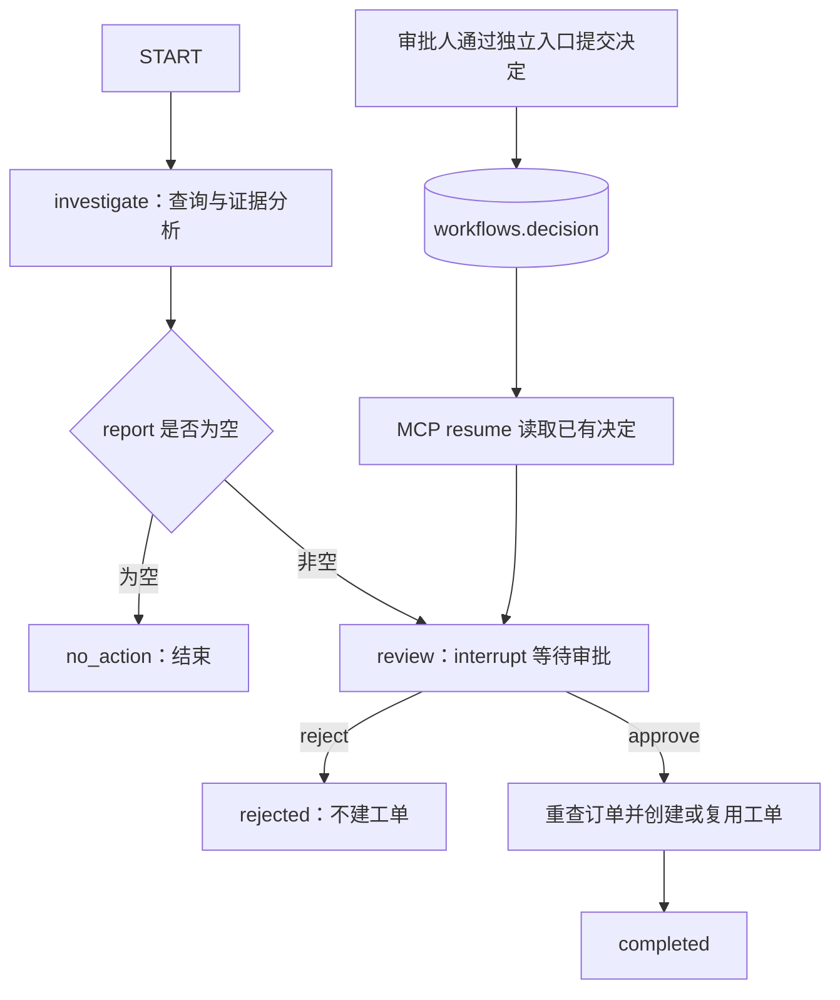

# 第六章：接入 LangGraph 工作流

只读排查完成后，用户可能希望继续创建处理工单。这时任务已经跨越多个步骤：查询订单、组织报告、等待审批、检查订单变化、创建工单、返回结果。LangGraph 用状态和节点保存这些步骤，让暂停与恢复成为服务端可检查的行为。

## 6.1 Skill 与工作流各负责什么

Skill 指导 Codex 如何开展任务、何时询问以及怎样解释结果。LangGraph 保存当前流程执行到哪里、此前生成了什么清单、恢复后应该继续哪个节点。

关闭 Codex 会话不会自动删除服务端工作流；另一个客户端知道 workflow_id 并拥有相应权限后，仍然可以查询状态。反过来，即使同一个聊天还保留对话记录，服务端没有检查点也不能凭聊天内容恢复原来的执行位置。

| 内容 | 保存位置 | 原因 |
| --- | --- | --- |
| 查询顺序和报告格式 | Skill | 可供模型按需读取的方法 |
| 工作流登记、审批决定 | 业务数据库 workflows 表 | 服务端身份和审批依据 |
| 节点状态、report、执行位置 | LangGraph 检查点 | 暂停与恢复依据 |
| 创建后的工单 | 业务数据库 tickets 表 | 实际业务成果 |

## 6.2 理解 State、Node 与 Edge

[workflow.py](../../代码/ecommerce-agent/app/workflow.py) 定义 `State`，包含工作流编号、店铺、查询时间、状态、报告和工单结果。节点读取状态，返回需要更新的字段。边决定下一个节点。

本项目只有两个业务节点，使流程便于观察：



`investigate` 复用既有业务查询函数。没有异常时返回 `no_action`，不会要求无意义的审批。有异常时保存报告，并进入 `review`。

这些节点是确定性的 Python 逻辑，不需要在 LangGraph 中再调用一遍大模型。Codex 已负责理解自然语言；服务端只需准确执行固定业务步骤。

## 6.3 使用 interrupt 暂停

`review` 在写工单前调用 `interrupt()`，向客户端返回工作流编号、订单编号和待审批信息。LangGraph 保存检查点，状态停在 `awaiting_approval`。

继续调用时使用 `Command(resume=True)`。这里的 `True` 仅表示允许图从中断处继续，不是审批决定；节点随后会读取数据库中的 `decision`。恢复 API 也会先检查这条决定是否存在。

这是一个关键区别：MCP 工具没有 `approved=true` 参数，因此模型无法只靠构造工具参数取得审批权。审批入口单独要求审批身份。

LangGraph 恢复时会从暂停节点的开头重新执行。因此，`interrupt()` 前面不放发邮件、扣库存或创建工单等副作用。后面的工单写入还需要幂等控制，因为进程可能在数据库提交后、检查点更新前退出。

## 6.4 三个编号不能混用

| 编号 | 示例与来源 | 作用 |
| --- | --- | --- |
| request_id | `order-demo-001`，调用者提供 | 同一次启动请求的幂等键 |
| workflow_id | 服务器生成 UUID | 查询、审批、恢复的业务标识 |
| thread_id | 使用相同 workflow_id | LangGraph 关联检查点 |

MCP 的连接会话标识不参与这三者的映射。重新启动MCP HTTP服务或重新连接后，继续传入原 workflow_id 即可查询同一流程。

同一个 request_id 和相同查询参数返回同一工作流。若日期或基准时间改变，应创建新的业务请求；混用原 request_id 会得到 409 冲突。

## 6.5 观察启动结果

可以让 Codex 执行：

```text
启动店铺 A 的订单异常处理工作流。
paid_on 为 2026-10-10，as_of 为 2026-10-11T12:00:00+08:00，
request_id 使用 order-demo-001。
展示工作流编号和待审批清单，到等待人工审批时停止。
```

对应工具为 `ecommerce_start_workflow`。返回的 `report` 应包含 A1001、A1002、A1003，`status=awaiting_approval`，`tickets=[]`，`decision=null`。

这时要求恢复，服务端应返回 409，提示尚未获得人工审批。此结果证明流程停在了业务审批环节，而不是仅在聊天中说“等待确认”。

## 6.6 人工提交审批

审批人打开独立终端，进入工程目录，将 `WORKFLOW_ID` 替换成真实编号：

```powershell
uv run --frozen python -m app.approve WORKFLOW_ID --decision approve
```

[approve.py](../../代码/ecommerce-agent/app/approve.py) 会隐藏读取审批令牌，先展示服务端保存的报告，再要求输入工作流编号确认。决定提交到 `POST /workflows/{workflow_id}/decision`。

如果不接受该清单，使用 `--decision reject`。未完成终端确认则不提交任何决定。提交后的决定不能被另一种意见覆盖；重复提交同一决定返回现有状态。

本地课程通过两个令牌演示角色差异。同机可读的 `.env` 不能防止拥有文件访问能力的 Agent 读到审批凭据；企业应把 API 与审批凭据放在 Agent 无法读取的服务环境，由独立用户身份完成审批。

## 6.7 恢复并解释结果

回到 Codex：

```text
工作流 WORKFLOW_ID 已通过独立入口完成审批。
先查询服务端状态，确认 decision 后再恢复。
根据返回结果分别列出新建工单、已有工单和因状态变化跳过的订单。
```

用真实编号替换提示词中的占位值。Codex 先调用 `ecommerce_workflow_status`，再调用 `ecommerce_resume_workflow`。

批准后，`review` 再次查询每个已批准订单是否仍符合原筛选条件。订单已发货或取消时返回 `skipped_changed`；已有工单时返回 `existing`；首次写入时返回 `created`。

初始化样本未被改动时应创建三张工单：`TK-A1001`、`TK-A1002`、`TK-A1003`。同一工作流重复恢复直接返回已完成结果；另一工作流再次处理相同订单，也会复用已有工单。

本例的唯一约束是一个订单只能对应一张工单。若公司允许关闭后重新开单，应先设计“订单＋异常类型＋业务周期”等唯一范围，再调整服务端规则。

## 6.8 检查点如何跨重启保存

项目使用 `SqliteSaver` 保存检查点，路径由 `CHECKPOINT_PATH` 控制。它与保存订单的 MySQL 是两个用途不同的数据库。将检查点保存到文件，才能在 API 退出后重新加载；内存 saver 无法做到这一点。

在 `awaiting_approval` 时正常停止 API，再用相同环境和同一检查点路径重新启动：

```powershell
uv run --frozen python -m uvicorn app.api:app --host 127.0.0.1 --port 8000 --workers 1
```

查询原 workflow_id，仍应得到此前的待审批报告。保留业务数据库却更换检查点文件，或者反过来，都不能构成完整恢复。

配套测试提供真实 API 子进程的暂停、停止、重启、审批和 MCP 恢复验证：

```powershell
uv run --frozen pytest -q tests/test_live_stack.py
```

测试中的审批凭据只属于临时测试系统；该测试验证协议和状态恢复，不测试模型是否正确理解人的意图。

## 6.9 从课程流程走向企业部署

本例在单 API 进程中使用锁串行处理工作流，处理上限为 100 单。超限明确失败，不静默截断清单。更大任务需要服务端增加可审查的分批接口和后台执行能力。

业务数据库与检查点之间没有统一事务，工单唯一约束用来防止恢复时重复创建。多实例部署还需要数据库级并发控制、适合部署规模的检查点存储、审批有效期和审计记录，不能直接把 workers 改大就视为完成扩容。

报告保存的是调查时证据。恢复只检查订单资格，没有重新审批库存和履约的新变化；如业务要求证据变化后重新审批，应在服务端增加版本比对和重审分支。

关于 `interrupt()`、检查点和相同 `thread_id` 的恢复语义，可查阅 [LangGraph 中断与恢复](https://docs.langchain.com/oss/python/langgraph/interrupts)。

## 6.10 状态图的完整实现

先阅读 State 和构图过程，再按 investigate、review、start、decide、resume 的顺序理解方法。RLock 允许同一线程中的方法嵌套加锁；数据库事务确保本次工单写入一起提交，订单唯一约束负责防重。

<details>
<summary>app/workflow.py 完整代码</summary>

```python
"""LangGraph 状态管理；单 API 进程内以锁串行处理课程工作流。"""
from datetime import datetime, timezone
from threading import RLock
from typing import TypedDict
from uuid import uuid4
from langgraph.graph import StateGraph, START, END
from langgraph.types import interrupt, Command
from sqlalchemy import select, update
from app import business
from app.db import workflows, tickets, orders


class Conflict(ValueError):
    pass


class State(TypedDict, total=False):
    workflow_id: str
    store: str
    paid_on: str
    as_of: str
    status: str
    report: list[dict]
    tickets: list[dict]


class WorkflowService:
    def __init__(self, engine, checkpointer):
        self.engine = engine
        self.lock = RLock()
        builder = StateGraph(State)
        builder.add_node("investigate", self.investigate)
        builder.add_node("review", self.review)
        builder.add_edge(START, "investigate")
        builder.add_conditional_edges("investigate", lambda state: "review" if state["report"] else END)
        builder.add_edge("review", END)
        self.graph = builder.compile(checkpointer=checkpointer)

    @staticmethod
    def config(workflow_id):
        return {"configurable": {"thread_id": workflow_id}}

    def record(self, workflow_id, store):
        with self.engine.connect() as conn:
            row = conn.execute(select(workflows).where(workflows.c.id == workflow_id,
                                workflows.c.store == store)).mappings().first()
        if row is None:
            raise LookupError("工作流不存在或无权访问")
        return dict(row)

    def investigate(self, state: State):
        page = business.list_orders(self.engine, state["store"], state["paid_on"], state["as_of"], 0, 100)
        if page["next_offset"] is not None:
            raise Conflict("单次工作流最多处理 100 单，请缩小服务端查询范围后再启动；本次未创建工单")
        report = [business.evidence(self.engine, state["store"], row["id"]) for row in page["items"]]
        return {"report": report, "tickets": [], "status": "awaiting_approval" if report else "no_action"}

    def review(self, state: State):
        interrupt({"workflow_id": state["workflow_id"], "order_ids": [r["order"]["id"] for r in state["report"]],
                   "message": "请由审批人通过独立入口核对清单并决定；MCP 恢复工具不具备审批权限"})
        record = self.record(state["workflow_id"], state["store"])
        if record["decision"] not in ("approve", "reject"):
            raise Conflict("尚无人工审批记录")
        if record["decision"] == "reject":
            return {"status": "rejected", "tickets": []}
        results = []
        with self.engine.begin() as conn:
            for item in state["report"]:
                order_id = item["order"]["id"]
                current = conn.execute(select(orders).where(orders.c.id == order_id,
                    business.predicate(state["store"], state["paid_on"], state["as_of"]))
                    .with_for_update()).mappings().first()
                if not current:
                    results.append({"order_id": order_id, "outcome": "skipped_changed"})
                    continue
                existing = conn.execute(select(tickets).where(tickets.c.order_id == order_id)).mappings().first()
                if existing:
                    results.append({**dict(existing), "outcome": "existing"})
                    continue
                ticket = {"id": f"TK-{order_id}", "order_id": order_id,
                          "workflow_id": state["workflow_id"], "status": "open"}
                conn.execute(tickets.insert().values(**ticket))
                results.append({**ticket, "outcome": "created"})
        return {"status": "completed", "tickets": results}

    def status(self, workflow_id, store):
        with self.lock:
            record = self.record(workflow_id, store)
            snapshot = self.graph.get_state(self.config(workflow_id))
            result = dict(snapshot.values)
            if not result:
                result = {"workflow_id": workflow_id, "status": "not_started", "report": [], "tickets": []}
            if any(task.error for task in snapshot.tasks):
                result["status"] = "failed"
            result["decision"] = record["decision"]
            result["decided_at"] = (record["decided_at"].replace(tzinfo=timezone.utc).isoformat()
                                    if record["decided_at"] else None)
            return result

    def start(self, store, paid_on, as_of, request_id):
        business.scope(paid_on, as_of)
        params = {"paid_on": paid_on, "as_of": as_of}
        with self.lock:
            with self.engine.begin() as conn:
                old = conn.execute(select(workflows).where(workflows.c.request_id == request_id)).mappings().first()
                if old and (old["store"] != store or old["params"] != params):
                    raise Conflict("request_id 已用于不同参数，请使用新的请求编号")
                workflow_id = old["id"] if old else str(uuid4())
                if not old:
                    conn.execute(workflows.insert().values(id=workflow_id, request_id=request_id, store=store, params=params))
            config = self.config(workflow_id)
            snapshot = self.graph.get_state(config)
            if not snapshot.values:
                self.graph.invoke({"workflow_id": workflow_id, "store": store, **params}, config)
            return self.status(workflow_id, store)

    def decide(self, workflow_id, store, decision):
        with self.lock:
            record = self.record(workflow_id, store)
            if record["decision"]:
                if record["decision"] != decision:
                    raise Conflict("审批记录已提交，不能改写")
                return self.status(workflow_id, store)
            if self.status(workflow_id, store)["status"] != "awaiting_approval":
                raise Conflict("仅等待审批的工作流允许提交决策")
            with self.engine.begin() as conn:
                conn.execute(update(workflows).where(workflows.c.id == workflow_id).values(
                    decision=decision, decided_at=datetime.now(timezone.utc).replace(tzinfo=None)))
            return self.status(workflow_id, store)

    def resume(self, workflow_id, store):
        with self.lock:
            record = self.record(workflow_id, store)
            config = self.config(workflow_id)
            snapshot = self.graph.get_state(config)
            if not snapshot.next:
                return self.status(workflow_id, store)
            if not record["decision"]:
                raise Conflict("尚未获得人工审批；请审批人通过独立审批入口提交决定")
            self.graph.invoke(Command(resume=True), config)
            return self.status(workflow_id, store)
```

</details>

[上一章：制作企业业务 Skills](05-制作企业业务Skills.md) · [下一章：完成端到端业务任务](07-完成端到端业务任务.md) · [项目目录](README.md)
