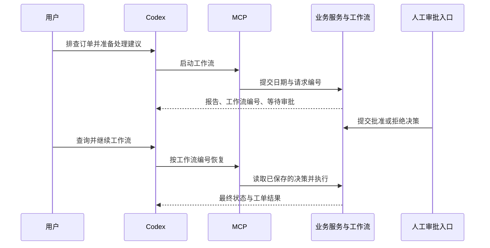

# 第七章：完成端到端业务任务

## 7.1 从一个业务请求开始

现在将已有的订单接口、Python 程序、业务 Skill 和 LangGraph 工作流连起来，完成一次“排查、报告、审批、建单”的业务处理。

整个流程使用虚构的店铺 A 数据。付款日期固定为 `2026-10-10`，检查时刻固定为 `2026-10-11T12:00:00+08:00`，便于逐笔核对结果。

完整工程与启动方式见 [工程说明](../../代码/ecommerce-agent/README.md)。开始前，业务 API 应已启动，Codex 能够列出六个企业 MCP 工具，并能读取 `ecommerce-order-investigation` Skill。

## 7.2 区分 Agent 入口与人工审批入口

Codex 使用的 `AGENT_TOKEN` 只能访问授权的店铺 A 业务能力。审批人通过独立终端使用 `APPROVER_TOKEN` 提交决策。

审批凭据不应加入 Codex 的环境、MCP 配置、聊天内容或报告文件。这个分离使服务端能够区分“Agent 请求继续处理”和“人已经做出审批决策”。

本地 `.env` 用于演示角色划分，同一操作系统账号可读的配置文件并不构成安全隔离。企业部署时，应将数据库与审批凭据留在远端 API 服务环境，并限制 Codex 的文件权限，使其无法读取这些凭据。



## 7.3 在 Codex 中发起任务

输入以下请求：

```text
使用 ecommerce-order-investigation 处理店铺 A 的订单异常。
付款日期：2026-10-10。
检查时刻：2026-10-11T12:00:00+08:00。
检查已付款但严格超过 24 小时仍未发货的订单，结合库存与履约记录，
列出事实、原因推测和处理建议。
本次 request_id 使用 demo-a-20261010-001。
请启动处理工作流；创建工单前等待人工审批。
返回工作流编号、当前状态和完整报告，不要把建议写成已完成的操作。
```

`request_id` 标识同一项启动请求。网络重试时继续使用相同编号，可以避免同一请求被重复启动。改变日期或检查时刻时，应使用新编号；同编号配不同参数会产生冲突。

Codex 应调用 `ecommerce_start_workflow`，保留返回的 `workflow_id`。这个编号用于后续查询与恢复，不能根据订单编号自行猜测。

## 7.4 核对暂停前的报告

在本次固定数据中，三笔订单应出现在异常清单里：

| 订单 | 截至检查时刻已付款时长 | 库存与履约证据 | 处理方向 |
| --- | --- | --- | --- |
| A1001 | 28 小时 | 需求 2 件，当前库存 0 件 | 核实补货或调拨方案 |
| A1002 | 27 小时 | 当前库存 20 件，存在仓库拦截记录 | 核实拦截原因 |
| A1003 | 26 小时 | 当前库存 20 件，未查到履约记录 | 继续核查下发与履约链路 |

这里“超过 24 小时”采用严格大于。A1004 只有 18 小时，不在异常清单中；已发货的 A1005 和已取消的 A1006 也不计入。

让 Codex 查询一次状态：

```text
查询刚才返回的工作流编号，列出 status、报告中的订单编号和 tickets。
```

此时预期 `status` 为 `awaiting_approval`，`tickets` 为空。报告中的“建议创建工单”是一项待执行建议，还不是数据库中的处理记录。

## 7.5 在独立终端提交人工决策

审批人阅读报告，确认处理范围后，在工程目录的独立终端运行：

```powershell
uv run --frozen python -m app.approve 实际工作流编号 --decision approve
```

把 `实际工作流编号` 替换为工具返回的值。命令会通过隐藏输入提示读取审批 Token，然后打印服务端报告。阅读清单后，再输入工作流编号确认，命令才会提交决策；不要将 Token 直接拼在命令行中。

审批只是保存决策。后续仍需恢复工作流，才能执行批准之后的节点。这样能清楚区分“决策已经提交”和“处理已经完成”。

若审批人不同意处理，使用：

```powershell
uv run --frozen python -m app.approve 实际工作流编号 --decision reject
```

批准与拒绝是两个分支，只提交符合本次意图的一个决策。命令实现见 [approve.py](../../代码/ecommerce-agent/app/approve.py)。

## 7.6 恢复工作流并检查工单

人工批准完成后，在 Codex 中输入：

```text
人工审批已经通过独立入口提交。
请查询刚才的工作流，然后使用该 workflow_id 恢复工作流。
最后再次查询状态，汇总实际创建或已存在的工单，不要重复创建。
```

`ecommerce_resume_workflow` 只接收工作流编号。服务端读取已有审批记录，决定继续创建工单还是结束为拒绝状态。

批准路径预期返回 `completed`，并得到以下处理工单：

| 工单编号 | 关联订单 |
| --- | --- |
| TK-A1001 | A1001 |
| TK-A1002 | A1002 |
| TK-A1003 | A1003 |

工单表对订单关联实施唯一约束。再次恢复同一个已结束工作流，应返回已有结果；其他工作流处理到同一订单时，也不应为该订单重复创建工单。

逐项核对 `tickets` 中的 `outcome`：`created` 是本次新建，`existing` 是复用已有工单。若审批期间订单已发货或已不满足筛选条件，恢复时会返回 `skipped_changed`，不能把这种跳过也算作创建成功。

工单创建完成只表示异常进入处理队列，不表示仓库已经发货，也不表示库存已经补齐。最终报告应清楚写出这个业务状态。

若提交的是拒绝决策，恢复后状态应为 `rejected`，不会创建本次处理工单。未发现异常的任务则可直接结束为 `no_action`。

## 7.7 保存可交接的结果

在 Codex 中输入：

```text
根据本次工作流的最终查询结果，在当前项目的 outputs 目录保存以下文件；
如果同名文件已存在，另建带本次工作流编号的文件，不覆盖旧记录：
1. 订单异常报告.md：包含日期、检查时刻、范围、事实、原因推测、建议及处理状态。
2. 订单异常结果.json：保存工具返回的工作流状态、报告和工单信息。
记录真实 workflow_id；没有查到的字段不要补造。
```

Markdown 适合阅读，JSON 适合后续程序处理。两份文件的订单编号、数量、工单编号应能对应；状态发生变化后，应重新查询并更新报告，而不是依据旧对话猜测状态。

## 7.8 用 WorkBuddy 整理 Word 与 Excel

将上述两份输出放到 WorkBuddy 的工作目录，输入：

```text
读取订单异常报告.md和订单异常结果.json，整理两份交付文件：
一、订单异常报告.docx：包含排查范围、异常汇总、逐笔证据、处理建议、工单状态。
二、异常明细.xlsx：每笔异常一行，列出订单编号、事实、原因推测、建议、工单编号。
仅使用输入资料；未知内容保留“待确认”。
两份文件的订单数量和工单状态必须与JSON一致。
将表头、列宽、换行和日期格式整理为便于阅读的样式。
```

这里由 WorkBuddy 根据已有结果制作办公文档。业务工作流负责查询和处理，办公文档负责呈现这些结果；格式美化不应改变事实和审批状态。

## 7.9 更换输入时观察流程复用

将检查时刻提前，部分订单可能尚未超时。使用新的 `request_id` 发起任务，报告应按照新时间重新计算，而不是继续输出固定的三笔订单。

若提出查询店铺 B 的请求，店铺 A 的 Agent 凭据不能获得其订单证据。若 API 不可达，报告应说明查询失败，不应写成“今天没有异常”。

一次完整交付应能够串联业务请求、工作流编号、查询证据、人工决策和最终工单。阅读结果的人由此可以判断：查了什么、依据是什么、哪一步已经完成、哪一步仍需要业务人员处理。

[返回项目篇目录](README.md)
