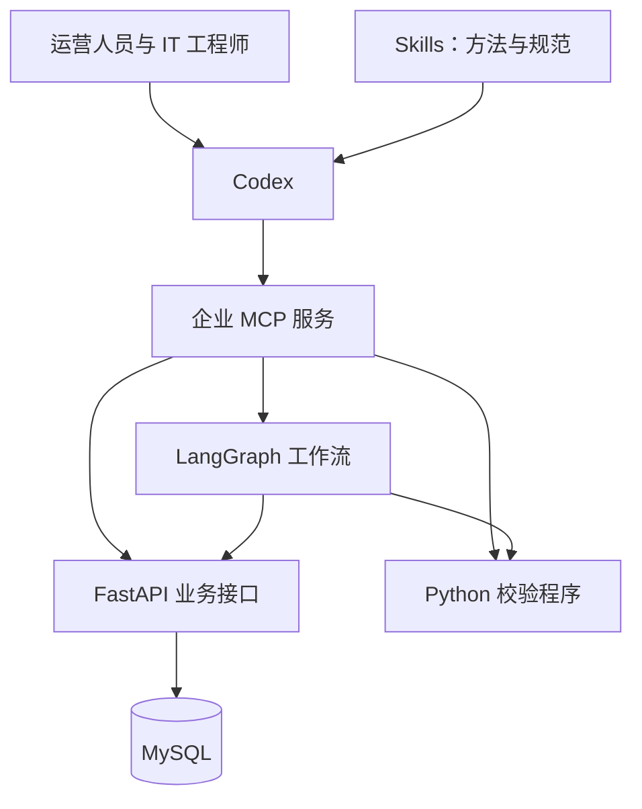

# 项目实战篇：以 Codex 为统一入口接入企业电商系统

[前置准备：依赖安装与后端项目启动](00-依赖安装与项目启动.md)：安装uv与Python 3.12，选择MySQL或SQLite路线，配置令牌、初始化数据、启动FastAPI并验证查询。

## 项目背景

一家电商公司已有 MySQL 数据库、FastAPI 业务接口、Python 校验程序和 LangGraph 工作流。员工通过 Codex 提出业务任务，工程师使用 MCP 接入已有能力，再用 Skills 组织可复用的操作流程。

项目以“订单异常排查与处理助手”为主线。基础工程使用虚构业务数据，提供启动说明与接口示例。

## 典型业务请求

> 检查昨天店铺 A 已付款但超过发货时限的订单，结合库存和履约记录说明可能原因，生成异常清单和处理建议。需要创建处理工单的，先给我确认。

## 技术分工

| 组件 | 职责 |
| --- | --- |
| Codex | 接收自然语言任务，调用工具，解释结果 |
| Skills | 保存查询顺序、判断规则、异常处理和报告要求 |
| MCP | 暴露业务工具，连接 Agent 与已有系统 |
| FastAPI | 提供业务接口，执行参数校验、认证和授权 |
| MySQL | 保存订单、商品库存、履约和工单数据 |
| Python | 执行确定性的校验、计算和数据转换 |
| LangGraph | 管理分支、执行状态、暂停与恢复 |

## 章节大纲

### 第一章：项目背景与架构

- 认识电商订单异常排查需求与员工使用方式。
- 区分 Codex、Skills、MCP 和已有系统的职责。
- 确定输入、输出、业务口径与验收依据。

成果：项目架构图、业务流程与需求清单。

### 第二章：认识已有电商系统

- 通过前端查询固定订单，理解超时范围与分页。
- 对比库存和履约证据，区分观测事实、规则判断与待确认原因。
- 认识五张业务表、HTTP接口、身份范围及请求数据流。
- 区分本地JSON校验、业务查询和有状态工作流，为后续接入选定能力。

成果：已有系统的业务规则、数据关系与能力清单。环境安装和服务启动见第00篇。

### 第三章：接入已有 Python 程序

- 梳理脚本输入、输出、退出码与依赖。
- 将校验与统计能力包装成 MCP 工具。
- 从 Codex 调用，检查正常输入、数据异常和执行失败。

成果：可由 Codex 调用的 Python 业务工具。

### 第四章：接入 FastAPI 与 MySQL

- 复用订单、库存和履约接口，选择需要暴露的 MCP 工具。
- 通过业务服务查询 MySQL，明确筛选、分页、统计口径与授权。
- 区分无数据、接口错误与权限不足，返回可核对的结构化结果。

成果：可查询业务数据的企业 MCP 服务。

### 第五章：制作企业业务 Skills

- 设计订单异常排查 Skill 的触发条件、边界和步骤。
- 组织 MCP 工具调用，加入业务口径和报告模板。
- 用不同订单样例检查触发、执行和成果。

成果：订单异常排查 Skill 与评测样例。

### 第六章：接入 LangGraph 工作流

- 建立查询、分析、分支处理和人工确认流程。
- 设计工作流编号、检查点、状态查询与恢复。
- 通过 MCP 暴露启动、查询和恢复工具，区分 Skill 指导与服务端状态控制。

成果：可暂停、查询和恢复的异常处理工作流。

### 第七章：完成端到端业务任务

- 在 Codex 中提出超时未发货订单排查需求。
- 查询订单、关联库存与履约证据，生成异常清单和处理建议。
- 经确认创建工单，再查询状态并汇总结果。
- 更换输入检查复用，必要时用 WorkBuddy 将结果整理为 Word 与 Excel。

成果：完整业务处理记录与结果报告。

## 接入设计要点

先复用已有程序和接口，再引入复杂流程。MySQL 通过有明确用途的业务查询能力接入；计算和状态转换由服务端执行。Skill 描述操作方法，服务端负责权限、状态和幂等控制。

LangGraph 的状态流程显式使用工作流编号关联检查点，不能把 MCP 连接成功等同于业务会话能够自动恢复。选择模型路线时，分别检查模型工具调用与业务结果；服务端业务规则保持一致。

## 官方参考

- [Codex MCP 接入](https://learn.chatgpt.com/docs/extend/mcp?surface=cli)
- [Skills 与 MCP 的分工](https://developers.openai.com/plugins/concepts/skills)
- [FastAPI 与 FastMCP 集成](https://gofastmcp.com/integrations/fastapi)
- [MySQL Python 查询接口](https://dev.mysql.com/doc/connector-python/en/connector-python-example-cursor-select.html)
- [LangGraph MCP 接口](https://docs.langchain.com/langsmith/server-mcp)
- [LangGraph 中断与恢复](https://docs.langchain.com/oss/python/langgraph/interrupts)

[返回课程总纲](../00-课程大纲.md)
